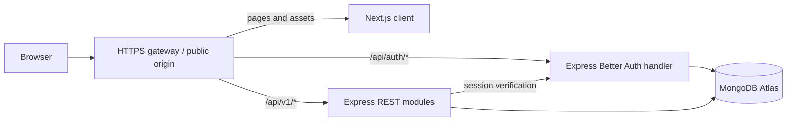

# Architecture proposal

Milestone 05 assessment module reuses current Better Auth/fresh-role guards and MongoDB pool. Transactions serialize attempt start/save/submit, expiry and teacher close/release through a per-quiz write gate. MongoDB `$$NOW` supplies deadlines; immutable keys remain server-side. A 15-second worker settles abandoned attempts; request-time settlement independently enforces expiry. Next.js uses guarded student catalog/attempt/history and staff reports with existing Recharts. See [assessment architecture](quiz-assessments.md). No dependency additions or live database writes during verification.

Milestone 05 Lesson 01 adds a modular management-only quiz schema/repository/service/router behind current auth/RBAC, with MongoDB ownership/version/state filters. Next.js uses the existing RoleGuard, RHF/Zod/shadcn plus a dynamic MCQ field array. Keys are never returned through student APIs. See [quiz architecture](quiz-management.md).

Milestone 04 Lesson 05 adds a read-only analytics module behind existing admin/session middleware and a guarded Next.js chart dashboard. MongoDB facets calculate all statistics; client Recharts 3.10.1 only presents validated aggregate data, with accessible tables and empty/error states. See [analytics architecture](membership-analytics.md).

Milestone 04 Lesson 04 extends the membership module for approved students' own-profile management, with existing session/RBAC/origin checks and four-field Zod allowlisting. Next.js reuses RoleGuard, React Hook Form and shadcn form controls. Public profiles read the same record but retain their smaller projection. See [profile architecture](member-profile-management.md).

Milestone 04 Lesson 03 extends the existing public member module and adds Next.js directory/profile views using shadcn cards. Approved membershipApplications are the shared source for review, public profiles and statistics. API queries enforce approval and public projections; client reads omit credentials and caching. See [directory architecture](member-directory.md).

Milestone 04 Lesson 02 extends the existing membership module with admin listing and atomic review. The existing Express admin role guard and exact-origin mutation check protect every operation; Next.js adds a guarded management page and native confirmation dialog. Student status projections now include review outcome details. See [review architecture](membership-review.md).

Milestone 04 Lesson 01 adds a modular membership-applications schema/routes/controller/service/repository using the existing MongoDB connection and session/RBAC middleware. The Next.js form reuses RoleGuard, shadcn form controls, React Hook Form, Zod and toast. No packages are added. See [membership flow](membership-application.md).

Milestone 03 Lesson 05 adds native Better Auth in-memory rate limits with a server-owned socket IP header, Helmet API headers, no-store responses, safer logging, and compatible Next.js headers. Existing sessions, cookies, role lookups, and deployment trust settings are preserved. See [authentication security review](auth-security.md).

Checkpoint D adds client-side RoleGuard and dashboard routing based on Better Auth session roles, followed by an authoritative Express overview request before rendering personalized content. No protected data is server-rendered and no backend or database changes are introduced. See [frontend dashboard architecture](role-dashboards.md).

Checkpoint C adds request-scoped session verification, typed Express locals, strict single-role authorization, and fresh primary MongoDB role reads. Better Auth custom roles grant management permissions only to admin. Its existing admin HTTP prefix also passes through the application role guard. CORS precedes all routes; Better Auth still precedes the JSON parser. No frontend role UI or account role changes are included. See [RBAC implementation](rbac.md). Earlier checkpoint notes below are historical.

Checkpoint B adds offline first-admin bootstrap tooling only. It is not imported by application startup or HTTP routes. Default/check/dry-run modes are read-only; execute requires server-only settings, independent ownership review and interactive confirmations. A MongoDB transaction plus a permanent unique systemState marker coordinates concurrent bootstrap runs. Auth and tooling share AUTH_USER_COLLECTION; auth's adapter can be injected in memory-only tests. No role middleware or dashboards were added. See admin-bootstrap.md.

Milestone 03 Lesson 01 implemented: server-only Better Auth 1.7.18 with the matching MongoDB adapter shares the existing client/database. Startup connects MongoDB, ensures core auth indexes, initializes auth and creates the Express app. Credentialed CORS precedes /api/auth/*splat, which precedes express.json(). Health and /api/members/count remain public. See milestone-03-lesson-01.md for the installed-version findings and verification. Frontend auth and role enforcement are not part of this lesson.

Status: pending approval. Two independent applications, one repository, one public origin recommended.

Milestone 01 update: Next.js/Vercel and a separate Express service are confirmed. Independent apps now exist. The active homepage fetches http://localhost:5000/api/health on the Next.js server at request time, inside a Suspense boundary. API_URL configures that server-side origin; the existing public API variable/default is a fallback. Exact-origin CORS remains configured for future browser requests. Production same-origin routing remains a recommendation to validate before authentication. Node 24.x, strict TypeScript and independent npm lockfiles are configured. Database/auth and the deeper module layout below remain planned. Earlier Bangla/English foundation messages remain available; the active simplified homepage is English.

## Boundaries and structure

```text
ngc-science-club/
  client/                 # Next.js App Router; own package.json and lockfile
    src/app/              # public, auth, and dashboard route groups
    src/components/       # UI primitives and reusable domain components
    src/features/         # forms, queries, and feature components
    src/lib/              # API client, auth client, locale messages
  server/                 # Express; own package.json and lockfile
    src/config/           # validated environment configuration
    src/auth/             # Better Auth setup and session integration
    src/db/               # MongoClient lifecycle, index/validator scripts
    src/middleware/       # auth, permissions, validation, errors, limits
    src/modules/          # members, teachers, quizzes, analytics, admin
    src/scripts/          # explicit admin provisioning and fictional seed data
    src/app.ts            # application factory, testable without listening
    src/server.ts         # startup, shutdown, listener
  docs/
  AGENTS.md
  README.md
```

These are proposed folders, not scaffolding created during Phase 1. Avoid a shared package/build system initially; REST contracts document the boundary.

Within a server module: routes select the handler; validation checks input; controller translates HTTP; service enforces business rules; repository performs database operations. Keep trivial operations small rather than creating abstractions without a purpose.

## Request flow



The gateway is routing infrastructure, not a third application. Use a hosting reverse proxy or verified Next.js rewrites that preserve cookies, methods, and headers. Public URL example: https://club.example.edu.bd. Keep the domain hypothetical until confirmed.

During development, Next.js runs on localhost:3000 and Express on localhost:5000. Prefer the same-origin /api proxy locally too. Test direct cross-origin access only when needed: explicit origin allowlist, credentials enabled, and browser fetch credentials included. Never combine credentialed CORS with wildcard origins.

For example, the browser requests GET /api/v1/members?search=amina&page=1&limit=12. Express validates filters, queries indexed MongoDB data, projects public fields, and returns JSON. TanStack Query manages interactive fetching, caching, and invalidation. A successful application mutation invalidates that student's membership query. Its cache is a UI convenience, not authorization.

Use Server Components for public page rendering where helpful. They access Express over a configured internal server URL, never MongoDB. Protected server rendering explicitly forwards the incoming session cookie and uses no-store; do not cache personal responses. Keep mutations in browser calls initially to avoid duplicating authentication handlers in Next.js. Clear private query state at logout and account changes.

## Authentication integration

Better Auth runs only on Express. The React auth client targets /api/auth on the public origin; it handles signup, login, logout, verification, and recovery using Better Auth's routes. The browser stores an HttpOnly session cookie; application JavaScript does not store login tokens in localStorage.

Verified official Express guidance: use ESM; mount toNodeHandler before express.json(); use the correct wildcard syntax for the chosen Express major; retrieve sessions through auth.api.getSession with fromNodeHeaders. See [Express integration](https://better-auth.com/docs/integrations/express).

The current official MongoDB documentation uses @better-auth/mongo-adapter with the native MongoClient. Recheck imports and compatible versions when installing; older examples use a different import path. Use Atlas transaction support and configure the adapter/client accordingly. See [MongoDB adapter](https://better-auth.com/docs/adapters/mongo).

Protect each API by verifying the database session, checking current role/account status, and checking ownership or membership as needed. Keep role assignments server-owned and non-writable through signup/profile APIs. Sensitive authorization reads authoritative role state rather than trusting stale browser data or a cached session role.

Production cookies: HTTPS, HttpOnly, Secure, SameSite=Lax with a narrow host scope by default. Use exact trusted origins. Do not disable CSRF/origin checks to make deployment work. Same-origin routing avoids dependence on third-party cookie acceptance; verify proxy behavior in an early auth smoke test. See [cookie guidance](https://better-auth.com/docs/concepts/cookies).

Better Auth protections apply to its handler, not automatically to our custom REST mutations. Require trusted Origin on browser state-changing custom routes, JSON content types and explicit methods; reject missing/untrusted origins under the browser-only MVP policy. Configure proxy trust narrowly and reject unexpected public hosts. CORS alone is not CSRF protection. See [security guidance](https://better-auth.com/docs/reference/security).

## Admin provisioning

No public admin signup or default password. Proposed initial process: owner creates and verifies a normal account; an operator runs an explicit server-side command to promote that exact user ID in an otherwise unprovisioned environment. It refuses to bootstrap when an admin already exists. Serialize concurrent provisioning with a unique database marker and a transaction, write an audit entry, and revoke existing sessions. Never print credentials. Later role changes require a current admin, recent authentication, an audit reason, and protection against removing the last active admin. Serialize that invariant as well. The script is not implemented in Phase 1.

## UI and package responsibilities

- Tailwind and shadcn/ui: consistent visual primitives; blue/teal and restrained purple on light backgrounds.
- React Hook Form: form interaction; Zod: field validation and server input contracts. Client validation improves feedback, server validation enforces rules.
- TanStack Query: remote interactive data state. Better Auth client owns auth interactions; avoid a second independent session store.
- React Hot Toast: supplementary action feedback; errors also appear inline with accessible announcements.
- Recharts: analytics visualizations with text/table equivalents. Lucide: consistent labeled icons.
- Centralized messages, locale-aware formatting, Unicode-friendly names, and no image-embedded text prepare English/Bangla support.

## Versions and deployment

Choose a supported Node LTS and mutually compatible stable Next.js/React, Express, Better Auth/adapter, TypeScript, Tailwind/shadcn versions in Phase 2. Verify engine and peer requirements then, commit separate lockfiles, and use reproducible installs in CI. Do not infer compatibility from newest version numbers. Next.js setup reference: [installation](https://nextjs.org/docs/app/getting-started/installation).

Deploy client and server independently with Atlas, private secrets, staging, readiness checks, structured redacted logs, and graceful MongoClient shutdown. Use least-privilege database users, restricted network access, and tested backups/restores. Add mail delivery before public verification/recovery. No production credentials in client environment variables; NEXT_PUBLIC values are public.

## Risks and responses

| Risk                                      | Response and verification                                                                                                                     |
| ----------------------------------------- | --------------------------------------------------------------------------------------------------------------------------------------------- |
| Cross-site cookies or proxy failures      | One public origin; verify login/logout/cookie propagation in deployed staging, including mobile browsers                                      |
| Privilege escalation or stale permissions | Field allowlists, current role lookup, ownership checks, session revocation; negative permission tests                                        |
| Student data disclosure                   | Explicit public DTOs, directory consent, private results, minimal collection, agreed retention and account removal policy                     |
| Duplicate approvals/attempts              | Unique indexes, conditional updates, transactions and concurrency tests                                                                       |
| Quiz cheating or timer manipulation       | Server time/scoring, immutable published content, no answer key in participant responses; no claim of proctored-exam security                 |
| Deployment restarts and deadline handling | Persist deadlines; derive expiry on requests and run an idempotent periodic finalizer; never rely on browser timers or process memory         |
| MongoDB schema drift                      | Versioned idempotent indexes/validators and migrations for app collections; adapter-compatible auth schema                                    |
| Abuse and oversized requests              | Auth/API rate limits, body/query limits, safe search, no raw Mongo operators, redacted errors; shared limiter before multiple server replicas |
| Slow analytics or busy quiz starts        | Appropriate indexes, pagination caps, connection pooling, realistic load tests; aggregate before adding infrastructure                        |
| Lost updates and audit gaps               | Version/expected-state updates, transactional state and audit writes, retry-safe operations                                                   |
| Email failure or missing budget           | Choose provider early, test delivery and recovery; local test mailbox for development                                                         |
| Growing scope                             | One approved milestone at a time; defer enhancements and document decisions                                                                   |
